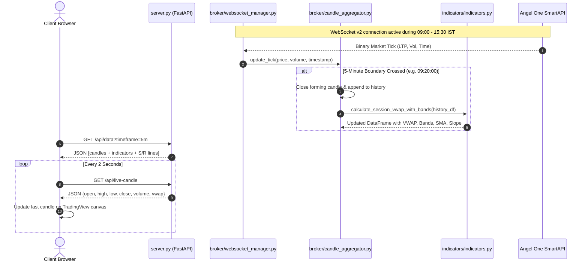
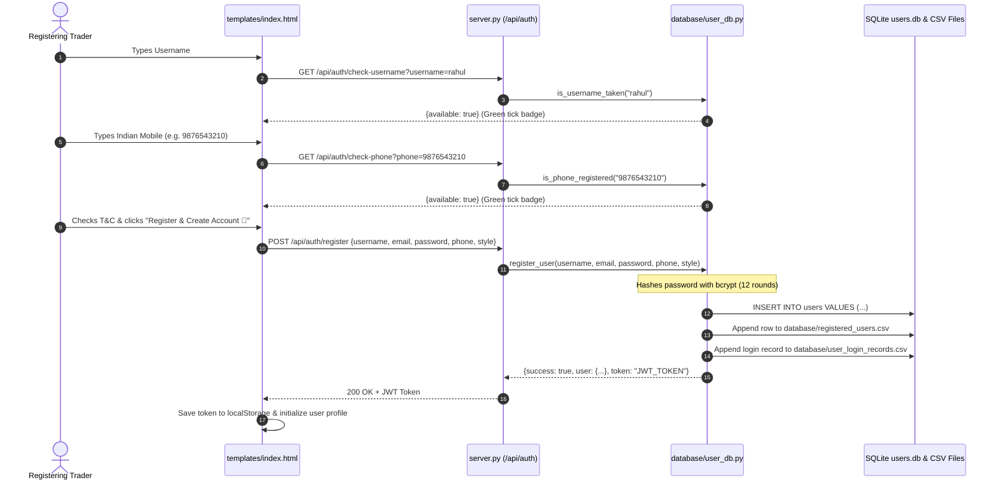
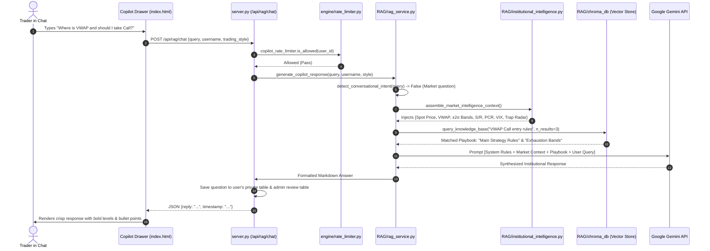

# 📘 NIFTY 50 VWAP Pro Terminal — Junior Developer & Architecture Master Handbook

> **Welcome to the Team!**  
> This handbook is written specifically for **junior developers, freshers, and non-technical stakeholders**. Whether this is your first day on the codebase or you need to make a critical feature modification, this document will guide you step-by-step through every file, permission, connection, and safety rule.  
> 
> Read this document carefully before making changes. It was designed so that **anyone can understand the architecture, locate the right file, make safe updates, and avoid breaking the production terminal.**

---

## 📑 Table of Contents
1. [Executive Overview & What This Terminal Does](#1-executive-overview--what-this-terminal-does)
2. [High-Level Architecture & Technology Stack](#2-high-level-architecture--technology-stack)
3. [Repository Directory & File Anatomy](#3-repository-directory--file-anatomy)
4. [File Access & Permissions Matrix (Who Reads/Writes What)](#4-file-access--permissions-matrix-who-readswrites-what)
5. [Feature-to-File Mapping (Who Handles What)](#5-feature-to-file-mapping-who-handles-what)
6. [How Files Are Connected (System Call Flow & Architecture Diagrams)](#6-how-files-are-connected-system-call-flow--architecture-diagrams)
7. [Critical & Sensitive Files ("The Red Zone — Do Not Touch Blindly")](#7-critical--sensitive-files-the-red-zone--do-not-touch-blindly)
8. [Change Impact Guide ("If I Want to Change Feature X, What Files Must I Edit?")](#8-change-impact-guide-if-i-want-to-change-feature-x-what-files-must-i-edit)
9. [Database Schemas & Data Storage Details](#9-database-schemas--data-storage-details)
10. [Market Operating Hours & Maintenance Window Policy](#10-market-operating-hours--maintenance-window-policy)
11. [Junior Developer Setup & Verification Runbook](#11-junior-developer-setup--verification-runbook)

---

## 1. Executive Overview & What This Terminal Does

The **NIFTY 50 VWAP Pro Terminal** is an institutional-grade, real-time algorithmic trading and quantitative analytics workstation built specifically for the **NIFTY 50 Index** (National Stock Exchange of India - NSE).

Unlike basic retail charting platforms, this system solves the biggest problems faced by retail day traders:
1. **Zero Artificial Spot Volume**: Spot indices like NIFTY 50 do not trade directly and therefore show fake or zero volume on retail platforms. This terminal aggregates live real-time trading volumes across all **50 underlying constituent stocks** (Reliance, HDFC Bank, TCS, Infosys, etc.) to calculate true institutional volume.
2. **Session-Anchored VWAP & Exhaustion Bands**: Calculates the mathematical Volume-Weighted Average Price resetting strictly at **09:15:00 AM IST** daily, along with $\pm 1\sigma$ and $\pm 2\sigma$ statistical standard deviation bands to detect overbought exhaustion and oversold reversals.
3. **Live Derivatives & Options Chain**: Ingests live NSE option chain contracts every 60 seconds to compute Put-Call Ratio (PCR), Max Call Resistance, Max Put Support, and Max Pain strike.
4. **AI Strategy Copilot (RAG)**: An institutional conversational trading copilot powered by Google Gemini, equipped with a local vector database (ChromaDB) containing quantitative strategy playbooks, live market state, trap radar, and personalized user psychology.
5. **Multi-User Authentication & Compliance**: Secure 2-tab login/registration with strict Indian phone verification (`^[6-9]\d{9}$`), dual SQLite + CSV audit logging, dynamic indicator controls, on-chart drawing persistence, and full SEBI legal disclaimer gating.

---

## 2. High-Level Architecture & Technology Stack

The project follows a **Departmental Micro-Architecture** running on top of **FastAPI** and **Python 3.11**, backed by a high-performance **TradingView Lightweight Charts** WebGL canvas in the browser.

```mermaid
graph TD
    subgraph Data Feeds & External APIs
        NSE[NSE India Derivative Feeds]
        Angel[Angel One SmartAPI WebSocket]
        Gemini[Google Gemini 1.5 / 2.0 API]
        TG[Telegram Bot API]
    end

    subgraph Backend Core (Python 3.11 / FastAPI)
        Server[server.py - FastAPI Web Server]
        BrokerDept[broker/ - Ingestion & Market Feeds]
        EngineDept[engine/ - Strategy & Signals]
        IndicatorDept[indicators/ - Mathematical Analytics]
        RAGDept[RAG/ - Vector DB & AI Copilot]
        DBDept[database/ - User DB & Audit Mirror]
    end

    subgraph Storage & Persistence
        SQLiteUsers[(database/users.db)]
        ChromaStore[(RAG/chroma_db/)]
        CSVUsers[(database/registered_users.csv)]
        CSVLogins[(database/user_login_records.csv)]
        JSONCaches[temp_storage/*.json]
    end

    subgraph Frontend Single Page Application
        Browser[Client Browser - index.html]
        Canvas[TradingView Lightweight Charts v4]
        Drawings[Canvas Drawing Overlay]
        CopilotDrawer[AI Copilot Chat Interface]
        IndicatorModal[Dynamic Settings Modal]
        AuthModal[2-Tab Auth Modal]
    end

    Angel --> BrokerDept
    NSE --> BrokerDept
    BrokerDept --> EngineDept
    EngineDept --> IndicatorDept
    IndicatorDept --> Server
    Gemini --> RAGDept
    RAGDept --> Server
    Server --> Browser
    Browser --> Canvas
    Browser --> Drawings
    Browser --> CopilotDrawer
    Browser --> IndicatorModal
    Browser --> AuthModal
    Server <--> SQLiteUsers
    Server <--> ChromaStore
    Server <--> CSVUsers
    Server <--> CSVLogins
    Server <--> JSONCaches
    EngineDept --> TG
```

### The Tech Stack
* **Backend Framework**: [FastAPI](https://fastapi.tiangolo.com/) + [Uvicorn](https://www.uvicorn.org/) (High-speed asynchronous Python ASGI server).
* **Broker & Data**: [SmartApi Python SDK](https://github.com/angel-one/smartapi-python) (Angel One Connect v2) with WebSocket v2 binary streaming; `curl_cffi` for TLS fingerprint impersonation of NSE India derivatives endpoints.
* **Math & Analytics**: `pandas`, `numpy`, `scipy` for session VWAP, Bessel standard deviation, linear regression slope, and option Greeks.
* **Vector Database & AI**: [ChromaDB](https://www.trychroma.com/) for local semantic embeddings; Google Gemini API (`google-generativeai`) for Copilot intelligence.
* **Authentication & Security**: `bcrypt` password hashing, `python-jose` for JWT session tokens, strict regex Indian mobile validation (`^[6-9]\d{9}$`).
* **Frontend GUI**: Pure HTML5, modern CSS3 (glassmorphic dark theme), vanilla JavaScript, and [TradingView Lightweight Charts v4.1](https://tradingview.github.io/lightweight-charts/).

---

## 3. Repository Directory & File Anatomy

The codebase is organized into **Functional Departments**.  
> [!IMPORTANT]
> **Root Shims Warning**: In the root directory, files like `indicators.py`, `live_runner.py`, `user_db.py`, etc., are **compatibility shims** that redirect imports into subdirectories. **Never make substantive changes to root shims.** Always edit the implementation file inside its respective department folder (`broker/`, `engine/`, `indicators/`, `database/`, `RAG/`).

```
c:\Users\ASUS\OneDrive\Desktop\VWAP_final\
│
├── server.py                        # 🚀 Primary FastAPI web server & REST API route controller
├── config.py                        # ⚙️ Global system settings, Angel credentials & strategy thresholds
├── app.py                           # 🔌 Legacy runner entry point (launches server.py)
├── backtest.py                      # 🧪 Historical backtesting engine for ZFTF strategy
├── requirements.txt                 # 📦 Python dependency specifications
├── .env                             # 🔐 Secret environment variables (API keys, passwords, TOTP)
├── START_PERMANENT_FREE_LINK.bat    # ⚡ Windows one-click launcher (starts server + cloudflared tunnel)
│
├── broker/                          # 📡 BROKER & MARKET DATA DEPARTMENT
│   ├── smartapi_client.py           # Angel One SmartConnect REST client (TOTP login & session renewal)
│   ├── websocket_manager.py         # SmartWebSocketV2 live tick streamer (5-min boundary aggregator)
│   ├── candle_aggregator.py         # In-memory OHLCV builder (converts ticks into 5m candles)
│   ├── option_chain_fetcher.py      # Real-time NSE India Option Chain & Greeks scraper (curl_cffi)
│   ├── nifty50_volume_aggregator.py # 50-stock real-time constituent volume engine
│   └── nifty50_constituents.py      # Official NSE NIFTY 50 basket ticker mappings
│
├── engine/                          # ⚙️ EXECUTION & STRATEGY ENGINE DEPARTMENT
│   ├── strategy.py                  # Core ZFTF (Z-Score Trend Following) state machine
│   ├── signal_manager.py            # Signal tracking, entry/stop/target calculation & state caching
│   ├── live_runner.py               # Real-time execution loop linking broker ticks to strategy
│   ├── background_engine.py         # 24/7 background worker running strategy & Telegram alerts
│   ├── prediction_engine.py         # Next-candle and directional trend prediction algorithms
│   ├── rate_limiter.py              # In-memory sliding window rate limiter for API protection
│   ├── sms_service.py               # SMS gateway utilities (legacy/disabled)
│   └── telegram_notifier.py         # Outbound Telegram broadcast notifier for trading signals
│
├── indicators/                      # 📐 MATHEMATICAL INDICATORS DEPARTMENT
│   ├── indicators.py                # Session VWAP, ±1σ/±2σ bands, SMA, Z-Score, LinReg Slope
│   ├── support_resistance.py        # Dynamic S&R line & zone detector (24H live updates)
│   ├── sr_breakout_engine.py        # Real-time S&R touch, test, rejection, and breakout detector
│   └── pattern_detector.py          # Candlestick pattern recognition (Hammer, Doji, Engulfing)
│
├── RAG/                             # 🧠 AI STRATEGY COPILOT & KNOWLEDGE DEPARTMENT
│   ├── rag_service.py               # Master AI Copilot orchestrator & system prompt enforcement
│   ├── llm_client.py                # Google Gemini API connector with fallback handling
│   ├── rag_database.py              # ChromaDB vector store client & TF-IDF semantic search
│   ├── strategy_knowledge_data.py   # Curated institutional trading rules & playbook knowledge
│   ├── institutional_intelligence.py# Context assembler injecting live VWAP, S/R, and options into prompt
│   ├── trap_radar.py                # Institutional fakeout / Bull Trap / Bear Trap detector
│   ├── preflight.py                 # Multi-factor trade preflight checklist generator
│   └── chroma_db/                   # Persistent ChromaDB vector embedding storage on disk
│
├── database/                        # 🗄️ DATABASE & USER SECURITY DEPARTMENT
│   ├── user_db.py                   # SQLite manager (WAL mode), bcrypt hashing, JWT issuance
│   ├── users.db                     # SQLite database file (users, drawings, copilot chat history)
│   ├── registered_users.csv         # Human-readable spreadsheet mirror of registered users
│   └── user_login_records.csv       # Security audit log recording every login attempt
│
├── templates/                       # 🎨 FRONTEND USER INTERFACE
│   └── index.html                   # Monolithic SPA: TradingView canvas, Copilot drawer, Auth modal
│
├── static/                          # 📦 STATIC ASSETS
│   └── lightweight-charts.standalone.production.js  # TradingView Lightweight Charts library
│
├── temp_storage/                    # 💾 FAST RAM & DISK CACHE
│   ├── drawings.json                # User trendlines, zones, and pencil drawings backup
│   ├── sr_levels.json               # Detected S&R price levels cache
│   ├── option_chain_cache.json      # 60-second TTL snapshot of active NSE option chain
│   └── nifty50_volume_5m.csv        # 60-day historical constituent volume cache
│
├── tests/                           # 🧪 AUTOMATED TEST SUITE
│   ├── test_candles.py              # Verifies 5-minute candle aggregation
│   ├── test_indicators.py           # Validates VWAP, SMA, and Z-score calculations
│   ├── test_strategy.py             # Validates buy/sell signal state transitions
│   ├── test_institutional_rag.py    # Tests AI Copilot response generation
│   └── ...                          # 20+ additional unit and verification test scripts
│
└── scratch/                         # 🛠️ SCRIPTS & DEBUGGING HELPERS
    └── test_no_otp_registration.py  # Automated test script for Indian phone registration flow
```

---

## 4. File Access & Permissions Matrix (Who Reads/Writes What)

To avoid breaking database files or triggering concurrency deadlocks, refer to this permission matrix:

| File Name | Access Type | Read Targets | Write Targets | External Network / APIs | Sensitivity |
| :--- | :--- | :--- | :--- | :--- | :--- |
| `config.py` | Read-only | `.env`, System Environment | None | None | 🔴 CRITICAL |
| `server.py` | Read / Write | `templates/index.html`, `users.db`, caches | `temp_storage/*`, `users.db` | HTTP Clients (FastAPI routes) | 🔴 CRITICAL |
| `database/user_db.py` | Read / Write | `database/users.db`, `registered_users.csv` | `database/users.db`, `*.csv` | None | 🔴 CRITICAL |
| `broker/smartapi_client.py` | Read / Write | `.env` credentials | In-memory session tokens | Angel One REST API | 🔴 CRITICAL |
| `broker/websocket_manager.py`| Network / Read | In-memory candles | Memory tick queue | Angel One WebSocket v2 | 🟠 HIGH |
| `broker/option_chain_fetcher.py`| Network / Write| None | `temp_storage/option_chain_cache.json`| NSE India Derivatives | 🟠 HIGH |
| `broker/nifty50_volume_aggregator.py`| Network / Write| NSE archives | `temp_storage/nifty50_volume_5m.csv` | Yahoo Finance / NSE | 🟡 MEDIUM |
| `indicators/indicators.py` | Pure Math | DataFrame rows | None (returns Series/DF) | None | 🔴 CRITICAL |
| `indicators/support_resistance.py`| Read / Write | Historical candles | `temp_storage/sr_levels.json`| None | 🟠 HIGH |
| `engine/strategy.py` | Pure Logic | Candle row data | Signal state object | None | 🔴 CRITICAL |
| `engine/signal_manager.py` | Read / Write | Strategy state | In-memory signal history | None | 🟠 HIGH |
| `engine/telegram_notifier.py` | Network | Message payload | None | Telegram Bot API | 🟢 LOW |
| `RAG/rag_service.py` | Read / Compute | System prompts, Chat history | None | None | 🟠 HIGH |
| `RAG/llm_client.py` | Network | Prompt strings | None | Google Gemini API | 🟠 HIGH |
| `RAG/rag_database.py` | Read / Write | Knowledge docs | `RAG/chroma_db/*` | None | 🟠 HIGH |
| `templates/index.html` | Frontend Code | Browser DOM, LocalStorage | LocalStorage, Web APIs | Calls `/api/*` endpoints | 🔴 CRITICAL |

---

## 5. Feature-to-File Mapping (Who Handles What)

When you need to fix a bug or add a new capability, use this cheat sheet to instantly identify the relevant files:

### Feature 1: Real-Time Market Feed & 5-Minute Candle Resampling
* **Backend Ingestion**: [`broker/websocket_manager.py`](file:///c:/Users/ASUS/OneDrive/Desktop/VWAP_final/broker/websocket_manager.py) & [`broker/candle_aggregator.py`](file:///c:/Users/ASUS/OneDrive/Desktop/VWAP_final/broker/candle_aggregator.py).
* **API Endpoints**: `GET /api/data` (loads historical candles) and `GET /api/live-candle` (polls the currently forming candle).
* **Frontend Rendering**: `templates/index.html` inside `updateRealtimeCandle()` and `fetchData()`.

### Feature 2: Session VWAP & Standard Deviation Bands
* **Mathematical Calculation**: [`indicators/indicators.py`](file:///c:/Users/ASUS/OneDrive/Desktop/VWAP_final/indicators/indicators.py) in `calculate_session_vwap_with_bands()`.
* **Session Reset Logic**: Strict reset at **09:15:00 IST** daily.
* **Frontend Rendering**: Rendered as line series on TradingView canvas in `templates/index.html` (`vwapSeries`, `upperBandSeries`, `lowerBandSeries`).

### Feature 3: Dynamic Support & Resistance Levels
* **Calculation Engine**: [`indicators/support_resistance.py`](file:///c:/Users/ASUS/OneDrive/Desktop/VWAP_final/indicators/support_resistance.py) (`detect_support_resistance()`).
* **Cache File**: `temp_storage/sr_levels.json`.
* **API Endpoint**: `GET /api/sr-levels`.
* **Frontend Visuals**: Horizontal price lines with touch counts projected 100 candles forward on the canvas.

### Feature 4: NSE Options Chain, PCR & Max Pain
* **Fetcher Engine**: [`broker/option_chain_fetcher.py`](file:///c:/Users/ASUS/OneDrive/Desktop/VWAP_final/broker/option_chain_fetcher.py).
* **Cache Mechanism**: 60-second in-memory TTL with backup in `temp_storage/option_chain_cache.json`.
* **API Endpoint**: `GET /api/option-chain`.
* **Frontend Display**: Top macro metrics bar and dedicated Options Chain drawer table in `templates/index.html`.

### Feature 5: True 50-Constituent Basket Volume
* **Calculation Engine**: [`broker/nifty50_volume_aggregator.py`](file:///c:/Users/ASUS/OneDrive/Desktop/VWAP_final/broker/nifty50_volume_aggregator.py).
* **Stock List**: [`broker/nifty50_constituents.py`](file:///c:/Users/ASUS/OneDrive/Desktop/VWAP_final/broker/nifty50_constituents.py).
* **API Endpoint**: `GET /api/volume/constituents`.

### Feature 6: Algorithmic Signals & Telegram Broadcasting
* **State Machine**: [`engine/strategy.py`](file:///c:/Users/ASUS/OneDrive/Desktop/VWAP_final/engine/strategy.py) (`ZFTFStrategy`).
* **Signal Storage**: [`engine/signal_manager.py`](file:///c:/Users/ASUS/OneDrive/Desktop/VWAP_final/engine/signal_manager.py).
* **Broadcaster**: [`engine/telegram_notifier.py`](file:///c:/Users/ASUS/OneDrive/Desktop/VWAP_final/engine/telegram_notifier.py).
* **API Endpoint**: `GET /api/signal-history`.

### Feature 7: Multi-User Authentication & Indian Mobile Verification
* **Database Manager**: [`database/user_db.py`](file:///c:/Users/ASUS/OneDrive/Desktop/VWAP_final/database/user_db.py).
* **API Endpoints in `server.py`**:
  * `GET /api/auth/check-username`: Live username availability.
  * `GET /api/auth/check-phone`: Real-time duplicate Indian phone check.
  * `POST /api/auth/register`: Creates new user account with hashed password and role.
  * `POST /api/auth/login`: Verifies password and returns JWT token.
  * `GET /api/auth/me`: Verifies active session token.
* **Audit Mirrors**: Every registration appends to `database/registered_users.csv`; every login appends to `database/user_login_records.csv`.
* **Frontend UI**: 2-tab modal (`🔑 Log In` and `✨ Register`) in `templates/index.html` (lines 11575–11710).

### Feature 8: AI Strategy Copilot & Institutional RAG
* **Master Service**: [`RAG/rag_service.py`](file:///c:/Users/ASUS/OneDrive/Desktop/VWAP_final/RAG/rag_service.py).
* **LLM Caller**: [`RAG/llm_client.py`](file:///c:/Users/ASUS/OneDrive/Desktop/VWAP_final/RAG/llm_client.py).
* **Vector Store**: [`RAG/rag_database.py`](file:///c:/Users/ASUS/OneDrive/Desktop/VWAP_final/RAG/rag_database.py) using ChromaDB.
* **Context Builder**: [`RAG/institutional_intelligence.py`](file:///c:/Users/ASUS/OneDrive/Desktop/VWAP_final/RAG/institutional_intelligence.py).
* **API Endpoints**: `POST /api/rag/chat`, `GET /api/copilot/history`, `POST /api/copilot/clear-display`.
* **Frontend UI**: Sliding Copilot drawer on the right side of `templates/index.html`.

### Feature 9: Dynamic Indicators Modal & On-Chart Drawings
* **Drawing Persistence**: Handled via `GET /api/drawings`, `POST /api/drawings`, `DELETE /api/drawings/{id}`.
* **User Preferences**: `GET /api/user/preferences` and `POST /api/user/preferences` in `database/user_db.py`.
* **Frontend UI**: Gear icon modal (lines 11709–11730 in `templates/index.html`) allowing traders to toggle EMAs, SuperTrend, RSI, and adjust parameters live without reloading the page.

---

## 6. How Files Are Connected (System Call Flow & Architecture Diagrams)

### 6.1 Real-Time Market Data & Indicators Flow



### 6.2 User Registration & Verification Flow



### 6.3 AI Strategy Copilot RAG Flow



---

## 7. Critical & Sensitive Files ("The Red Zone — Do Not Touch Blindly")

Any unintended syntax error or logic change in these files can crash the live terminal, invalidate active trading sessions, or corrupt user databases:

### 🔴 1. `config.py` & `.env`
* **Why it's sensitive**: Contains private API secrets (Angel One API Key, Client ID, Password, TOTP Secret, Telegram Bot Token, JWT Secret).
* **Danger**: Pushing `.env` to Git exposes live trading accounts to the public. If variables are renamed, the backend will fail to connect on startup.
* **Safety Rule**: Keep `.env` in `.gitignore`. Never hardcode raw API tokens into Python code.

### 🔴 2. `database/user_db.py`
* **Why it's sensitive**: Controls all user tables, bcrypt password hashing, token issuance, and CSV synchronization.
* **Danger**: Modifying SQL queries improperly can lock the SQLite database or cause user login failures.
* **Safety Rule**: SQLite is run in **WAL mode** (`PRAGMA journal_mode=WAL;`). Always use parametrized queries (`?`, not string concatenation) to prevent SQL injection.

### 🔴 3. `indicators/indicators.py`
* **Why it's sensitive**: Houses the core mathematical equations for Session VWAP, Standard Deviation bands, and Z-Scores.
* **Danger**: Any alteration to the 09:15 AM session reset logic or Bessel variance correction will cause the bands to plot incorrectly, misleading live traders.
* **Safety Rule**: Always run `python -m pytest tests/test_indicators.py` after editing this file.

### 🔴 4. `broker/smartapi_client.py`
* **Why it's sensitive**: Handles the daily Angel One session lifecycle. Angel One automatically invalidates all auth sessions at **06:00 AM IST** every single morning.
* **Danger**: If the daily re-authentication logic (`ensure_valid_session()`) is altered, the terminal will stop receiving live data the next morning.

### 🔴 5. `templates/index.html`
* **Why it's sensitive**: A monolithic, highly optimized single-page dashboard containing TradingView Lightweight Charts canvas, event listeners, drawing overlays, and WebSocket/polling routines.
* **Danger**: Modifying HTML IDs or removing script functions can break chart rendering, dynamic indicator toggling, or user authentication popups.
* **Safety Rule**: Back up `templates/index.html` before making large frontend edits.

---

## 8. Change Impact Guide ("If I Want to Change Feature X, What Files Must I Edit?")

Use this actionable recipe guide whenever you are tasked with modifying or adding features:

### Scenario A: Adding a New Technical Indicator (e.g., ADX or MACD)
1. **Mathematical Calculation**: Open [`indicators/indicators.py`](file:///c:/Users/ASUS/OneDrive/Desktop/VWAP_final/indicators/indicators.py) and write the calculation function (e.g. `calculate_adx(df, period=14)`).
2. **Data Pipeline Attachment**: In [`server.py`](file:///c:/Users/ASUS/OneDrive/Desktop/VWAP_final/server.py), find `_prepare_chart_data()` and call your new function so the indicator series is attached to the JSON returned by `GET /api/data`.
3. **Frontend Canvas Line**: In [`templates/index.html`](file:///c:/Users/ASUS/OneDrive/Desktop/VWAP_final/templates/index.html), create a new series with `chart.addLineSeries()` or `chart.addHistogramSeries()`.
4. **Dynamic Indicator Modal**: Add a toggle checkbox and parameter inputs inside the Dynamic Indicator Settings modal (around line 11710 in `index.html`).

### Scenario B: Changing VWAP Multipliers (e.g., Adding a ±3σ Band)
1. **Indicators**: Open [`indicators/indicators.py`](file:///c:/Users/ASUS/OneDrive/Desktop/VWAP_final/indicators/indicators.py) in `calculate_session_vwap_with_bands()`. Add `df['upper_band_3'] = df['vwap'] + 3.0 * df['std']` and `df['lower_band_3'] = df['vwap'] - 3.0 * df['std']`.
2. **Server Serialization**: In [`server.py`](file:///c:/Users/ASUS/OneDrive/Desktop/VWAP_final/server.py), ensure `upper_band_3` and `lower_band_3` are included in the JSON output dictionary.
3. **Frontend**: In [`templates/index.html`](file:///c:/Users/ASUS/OneDrive/Desktop/VWAP_final/templates/index.html), add `upperBand3Series` and `lowerBand3Series`.

### Scenario C: Modifying User Registration Validation (e.g., Custom Phone Rules)
1. **Backend Validation**: Open [`database/user_db.py`](file:///c:/Users/ASUS/OneDrive/Desktop/VWAP_final/database/user_db.py). Find `sanitize_indian_phone()`. Modify the regex pattern (e.g., `^[6-9]\d{9}$`).
2. **Server Endpoints**: Check `POST /api/auth/register` and `GET /api/auth/check-phone` in [`server.py`](file:///c:/Users/ASUS/OneDrive/Desktop/VWAP_final/server.py) to make sure error messages match.
3. **Frontend Validation**: In [`templates/index.html`](file:///c:/Users/ASUS/OneDrive/Desktop/VWAP_final/templates/index.html), update `handleRegPhoneInput()` and `handleRegisterSubmit()` regex and warning hints.
4. **Automated Testing**: Run `python scratch/test_no_otp_registration.py` to confirm zero regression.

### Scenario D: Updating Copilot Knowledge or System Prompts
1. **System Instructions**: Open [`RAG/rag_service.py`](file:///c:/Users/ASUS/OneDrive/Desktop/VWAP_final/RAG/rag_service.py) and update `SYSTEM_INSTRUCTIONS`.
2. **Strategy Playbooks**: Open [`RAG/strategy_knowledge_data.py`](file:///c:/Users/ASUS/OneDrive/Desktop/VWAP_final/RAG/strategy_knowledge_data.py) and add new playbook dictionaries with `title`, `category`, and `content`.
3. **Re-seeding ChromaDB**: Run a quick Python command to re-seed:
   ```python
   from RAG.rag_database import RAGDatabase
   db = RAGDatabase()
   db.seed_strategy_knowledge(force_refresh=True)
   ```

### Scenario E: Changing Market Operating Hours or Maintenance Notices
1. **Registration Form Notice**: Edit the amber alert card in `form-auth-register` in [`templates/index.html`](file:///c:/Users/ASUS/OneDrive/Desktop/VWAP_final/templates/index.html#L11682).
2. **SEBI Legal Modal**: Edit Clause 6 in `sebi-modal-overlay` in [`templates/index.html`](file:///c:/Users/ASUS/OneDrive/Desktop/VWAP_final/templates/index.html#L11801).
3. **Backend Logic**: If automatic off-market sleep mode is added, update [`engine/background_engine.py`](file:///c:/Users/ASUS/OneDrive/Desktop/VWAP_final/engine/background_engine.py).

---

## 9. Database Schemas & Data Storage Details

The primary database is **`database/users.db`** (SQLite 3 with WAL journal mode).

### Key Tables Overview:
1. **`users`**:
   * `id` (TEXT PRIMARY KEY): Unique identifier (e.g. `usr_1793186371_078f37`).
   * `username` (TEXT UNIQUE): Lowercase user handle.
   * `email` (TEXT UNIQUE): User email address.
   * `password_hash` (TEXT): Secure bcrypt hash.
   * `phone` (TEXT): 10-digit Indian mobile number.
   * `role` (TEXT): `admin`, `trader`, or `guest`.
   * `trading_style` (TEXT): `intraday_scalper`, `day_trader`, `swing_trader`, etc.
   * `created_at` (TEXT): ISO 8601 creation timestamp.
2. **`user_drawings`**: Stores persistent user chart drawings (trendlines, horizontal lines, rectangles, pencil sketches) mapped per `user_id`.
3. **`user_preferences`**: Stores user-configured indicator settings (EMA lengths, RSI periods, colors) so each trader sees their personal layout upon login.
4. **`copilot_user_<username>`**: Dedicated per-user chat table storing questions, copilot answers, and timestamps.
5. **`copilot_queries_review`**: Consolidated admin review table allowing administrators to inspect queries and improve RAG embeddings.
6. **`user_login_records`**: Security audit log capturing timestamp, IP address, user agent, event type, and login status.

### The CSV Redundancy Mirror:
In addition to SQLite, the system automatically mirrors critical records to human-readable CSV files:
* [`database/registered_users.csv`](file:///c:/Users/ASUS/OneDrive/Desktop/VWAP_final/database/registered_users.csv): Every registered user account.
* [`database/user_login_records.csv`](file:///c:/Users/ASUS/OneDrive/Desktop/VWAP_final/database/user_login_records.csv): Every login attempt, failed attempt, and logout.

---

## 10. Market Operating Hours & Maintenance Window Policy

The terminal is designed specifically around official **National Stock Exchange of India (NSE)** market hours:

| Time Window (IST) | Operating State | Platform Behavior |
| :--- | :--- | :--- |
| **09:00 AM – 09:15 AM** | Pre-Market Routine | Ingests pre-market opening indications; initial order book sync. |
| **09:15 AM – 03:30 PM** | Active Market Hours | Live SmartAPI WebSocket streaming; real-time candle aggregation; VWAP & S/R recalculations every tick; Copilot active. |
| **03:30 PM – 04:00 PM** | Post-Market Closing | NSE official settlement prices published; day session summary calculated. |
| **04:00 PM – Next 09:00 AM** | Off-Market / Maintenance | Live feeds paused; system eligible for database updates, software patches, and server maintenance. |
| **Weekends & Trading Holidays** | Maintenance Window | Server may intermittently be offline or restarted for system upgrades. |

> [!NOTE]  
> Users are clearly notified of this schedule both on the registration form and in Clause 6 of the SEBI Disclaimer modal.

---

## 11. Junior Developer Setup & Verification Runbook

### Step 1: Clone / Navigate to Workspace
```powershell
cd c:\Users\ASUS\OneDrive\Desktop\VWAP_final
```

### Step 2: Verify Python Environment & Dependencies
```powershell
python --version   # Must be Python 3.10+ (Recommended: Python 3.11)
pip install -r requirements.txt
```

### Step 3: Check Environment Secrets
Ensure `.env` exists in the root directory and contains:
```ini
ANGEL_API_KEY=your_key_here
ANGEL_CLIENT_ID=your_client_id
ANGEL_PASSWORD=your_pin
ANGEL_TOTP_SECRET=your_totp_secret
JWT_SECRET=your_jwt_secret_key
DEFAULT_EXCHANGE=NSE
DEFAULT_SYMBOL=NIFTY 50
DEFAULT_TOKEN=99926000
```

### Step 4: Run Syntax & Compilation Sanity Check
Before running the server, always ensure Python files compile with zero syntax errors:
```powershell
python -m py_compile server.py database/user_db.py indicators/indicators.py RAG/rag_service.py
```

### Step 5: Launch the Terminal
```powershell
# Development launch:
python server.py

# Or production one-click launcher (creates public Cloudflare tunnel):
.\START_PERMANENT_FREE_LINK.bat
```

### Step 6: Test Local Health Endpoint
Open a new shell or browser tab:
```powershell
curl http://localhost:8000/health
# Expected Output: {"status":"healthy","service":"nifty50-pro-terminal"}
```
Access the dashboard at `http://localhost:8000`.

### Step 7: Run Automated Verification Tests
```powershell
# Test user registration without OTP:
python scratch/test_no_otp_registration.py

# Test indicators & math:
pytest tests/test_indicators.py
```

---

*End of Developer Handbook. If you encounter unexpected behavior or need architectural guidance, contact Lead Strategy Provider & Developer: **Rushit Bodra** (`rushitbodra@gmail.com`).*
